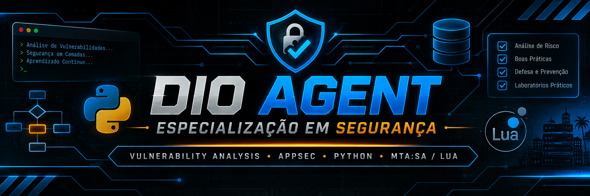
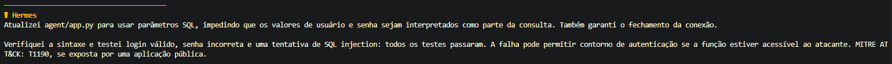
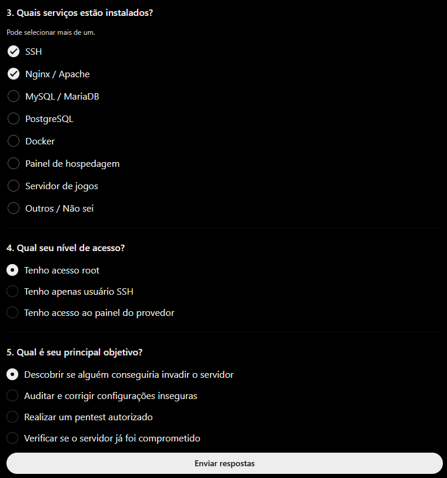
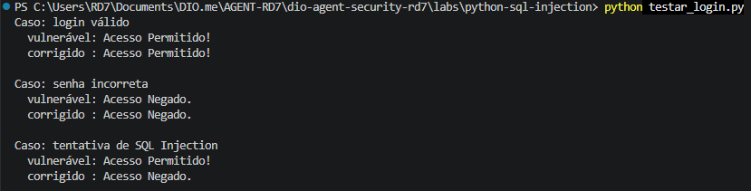
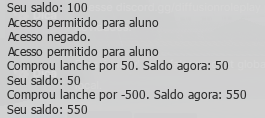
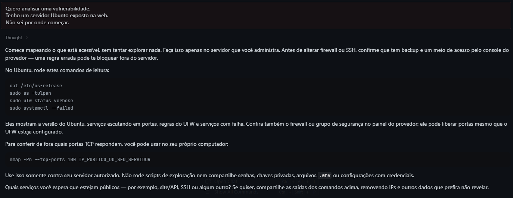

# DIO Agent Security

<p align="center">
  
</p>

> **Aviso:** todos os testes deste projeto foram realizados em ambiente próprio e controlado, com código escrito para o laboratório. Nenhum sistema de terceiros foi acessado.

Este repositório é a minha entrega do desafio de projeto do [DIO Agent](https://github.com/digitalinnovationone/dio-agent). A base é o agente da DIO, que ajuda estudantes a estudar e planejar a carreira. O que eu acrescentei foi uma especialização em segurança: uma skill nova, uma base de conhecimento, ajustes na persona e no `AGENTS.md`, e dois laboratórios para testar tudo.

Nenhum modelo foi treinado. O agente aprende pelo que está escrito nos arquivos. Isso é o mais interessante do projeto: dá para mudar o comportamento de um agente só editando Markdown.

---

## Ferramentas utilizadas

| Ferramenta | Utilidade |
| --- | --- |
| [Hermes](https://hermes-agent.nousresearch.com/) | Harness usado para rodar o agente no terminal. |
| [DIO Agent](https://github.com/digitalinnovationone/dio-agent) | Repositório base, com a persona e as skills originais. |
| [VS Code](https://code.visualstudio.com/) | Editor e terminal usados durante todo o processo. |
| [Git e GitHub](https://github.com/) | Versionamento e publicação do projeto. |
| [Python 3](https://www.python.org/downloads/) | Linguagem do primeiro laboratório. |
| [SQLite](https://www.sqlite.org/) | Banco usado nos dois laboratórios, sem servidor. |
| [MTA:SA](https://multitheftauto.com/) | Servidor de jogo usado no segundo laboratório, em Lua. |
| [Wiki do MTA](https://wiki.multitheftauto.com/) | Referência das funções de banco e de evento. |

---

## A especialização que eu dei ao agente

O DIO Agent original ensina bem. O que ele não tinha era um jeito de conduzir uma análise de segurança. Sem esse roteiro, ele responde o que foi perguntado e para por ali.

O primeiro teste foi com o arquivo `labs/python-sql-injection/app_vulneravel.py`. Pedi a ele, como especialista em AppSec, que encontrasse a falha, explicasse a exploração e corrigisse. A resposta foi tecnicamente correta:

- apontou a injeção de SQL;
- trocou a consulta por uma parametrizada;
- garantiu o fechamento da conexão;
- citou o T1190 do MITRE ATT&CK.

A análise ficou correta, mas incompleta: faltava dizer o **impacto**, a **probabilidade** e a **severidade**, que é o que permite decidir o que corrigir primeiro. Foi essa lacuna que a skill passou a cobrir. Hoje toda análise completa sai com as três informações e com o motivo da classificação.



### Agente especializado e chat genérico

A comparação que mais rendeu foi mandar a mesma pergunta para um chat genérico. A pergunta:

```text
Quero analisar uma vulnerabilidade.
Tenho um servidor Ubunto exposto na web.
Não sei por onde começar.
```

O chat genérico respondeu com uma lista de ferramentas (Nmap, Lynis, OpenVAS) e um formulário de cinco perguntas. Não está errado, mas é genérico: serve para qualquer pessoa, em qualquer cenário.

O agente especializado fez o caminho oposto. Antes de sugerir comando, avisou para não mexer em firewall ou SSH sem backup e sem acesso pelo console do provedor, e perguntou quais serviços eu esperava que estivessem públicos. Depois que eu confirmei que era laboratório, organizou a resposta em três blocos: o que já sabemos, o que falta descobrir e as três primeiras verificações.

| Ponto | Agente especializado | Chat genérico |
| --- | --- | --- |
| Ordem | Contexto, depois verificação | Ferramentas primeiro |
| Risco de se bloquear fora do servidor | Avisou antes de sugerir comando | Não mencionou |
| Escopo | Perguntou o que deveria estar exposto | Não chegou a esse ponto |
| Formato | Diagnóstico, lacunas e próximos passos | Lista e formulário |
| Adaptação ao meu nível | Disse o motivo de cada verificação | Despejou a lista completa |



A íntegra da resposta, transcrita sem edição, está em [`docs/comparacao-chat.md`](docs/comparacao-chat.md).

---

## O que eu criei e alterei

| Arquivo | O que mudou | Por quê |
| --- | --- | --- |
| `skills/vulnerability-analysis/SKILL.md` | Skill nova, com cinco etapas e formato de saída | É o roteiro que o agente segue na análise |
| `skills/vulnerability-analysis/README.md` | Explicação da skill para pessoas | Deixar claro o que ela faz e como testar |
| `skills/vulnerability-analysis/references/sql-injection.md` | Referência de injeção de SQL | Apoiar o agente no caso mais comum |
| `skills/vulnerability-analysis/references/mta-lua.md` | Referência de falhas em MTA:SA | Levar a skill para o meu ambiente real |
| `agent/knowledge/security-basics.md` | Fundamento de segurança ampliado | Dar base conceitual para a skill |
| `agent/persona.md` | Seção de segurança reescrita | Definir postura, não só assunto |
| `AGENTS.md` | Linha na tabela de skills e na base de conhecimento | Fazer o agente saber quando usar a skill |
| `labs/python-sql-injection/` | Laboratório em Python | Mostrar a falha e a correção em execução |
| `labs/mta/` | Laboratório em MTA:SA, em Lua | Provar que a skill funciona fora do Python |
| `docs/exemplo-relatorio.md` | Exemplo de análise no formato da skill | Fixar o padrão de saída |
| `docs/comparacao-chat.md` | Transcrição da resposta do chat genérico | Guardar a comparação em texto, sem precisar de várias imagens |

---

## Estrutura do repositório

| Caminho | Conteúdo |
| --- | --- |
| `AGENTS.md` | Definição do agente, com a tabela de skills. |
| `agent/persona.md` | Personalidade, tom e postura de segurança. |
| `agent/knowledge/security-basics.md` | Fundamentos de segurança usados na análise. |
| `skills/vulnerability-analysis/` | Skill nova: `SKILL.md`, `README.md` e as referências de SQL e MTA. |
| `labs/python-sql-injection/` | Login em Python, versão vulnerável e corrigida. |
| `labs/mta/` | Resources `lab_vulneravel` e `lab_corrigido`. |
| `docs/exemplo-relatorio.md` | Análise completa no formato da skill. |
| `docs/comparacao-chat.md` | Transcrição da resposta do chat genérico. |
| `images/` | Banner e prints usados no README. |

As demais skills e os documentos do DIO Agent original continuam como estavam.

---

## Como rodar o agente

1. Instale o Hermes seguindo a documentação oficial.
2. Clone este repositório.
3. Abra o terminal **dentro da pasta do projeto**. Esse detalhe importa: aberto em outra pasta, o Hermes não encontra o `AGENTS.md` nem as skills.
4. Rode `hermes` e converse normalmente.

```bash
git clone https://github.com/MateusRD7/dio-agent-security-rd7.git
cd dio-agent-security-rd7
hermes
```

O mesmo vale para outros harnesses compatíveis com `AGENTS.md`: abrir a pasta certa é o que faz o agente carregar a especialização.

---

## 1. A skill de análise de vulnerabilidades

A skill é um roteiro em Markdown. Ela não executa nada, só diz ao agente o que perguntar, em que ordem e como responder.

### 1.1. As cinco etapas

| Etapa | O que o agente faz |
| --- | --- |
| 1. Contexto e escopo | Descobre o sistema, se é laboratório ou produção e se é do estudante. Uma pergunta por vez. |
| 2. Entender a falha | Explica o que acontece, por que acontece e qual princípio de segurança é afetado. |
| 3. Avaliar o risco | Separa impacto de probabilidade e justifica a severidade. |
| 4. Investigar | Mostra o que olhar, por quê e só depois o comando. |
| 5. Corrigir e validar | Explica a correção, mostra como confirmar e pede para o estudante explicar com as próprias palavras. |

### 1.2. Critério de severidade

| Severidade | Quando |
| --- | --- |
| Crítica | Alcançável de fora, sem autenticação, com efeito amplo. |
| Alta | Precisa de login simples ou de pouca condição, com efeito amplo. |
| Média | Precisa de condição específica ou acesso restrito, com efeito limitado. |
| Baixa | Difícil de explorar ou efeito pequeno. |

O critério está escrito na skill. Sem isso, cada resposta classificaria a mesma falha de um jeito.

### 1.3. O formato de saída

Toda análise completa sai com as mesmas seções: resumo, falha e conceito, risco, investigação, correção, validação e aprendizado. O exemplo preenchido está em [`docs/exemplo-relatorio.md`](docs/exemplo-relatorio.md).

Padronizar o formato tem uma vantagem prática: dá para comparar dois casos lado a lado.

---

## 2. A base de conhecimento

O arquivo [`agent/knowledge/security-basics.md`](agent/knowledge/security-basics.md) reúne o que o agente precisa saber antes de analisar:

- diferença entre vulnerabilidade, ameaça e risco, com o exemplo do laboratório;
- tríade confidencialidade, integridade e disponibilidade;
- superfície de ataque e defesa em profundidade;
- princípios de projeto seguro, como menor privilégio e validação no servidor;
- como classificar severidade;
- MITRE ATT&CK e CWE, que são referências diferentes;
- escopo, autorização e cuidado com dados encontrados.

---

## 3. Persona e `AGENTS.md`

Na [`agent/persona.md`](agent/persona.md), a seção de segurança define comportamento: pergunta antes de opinar, explica o conceito antes da correção, não entrega payload pronto e só orienta defesa em ambiente autorizado.

No [`AGENTS.md`](AGENTS.md), a skill aparece na tabela e a base de segurança aparece na lista de conhecimento. É assim que o agente sabe que a skill existe.

---

## 4. Laboratório em Python

[`labs/python-sql-injection/`](labs/python-sql-injection/) tem duas versões do mesmo login e um script que roda os três casos nas duas.

Arquivo: `labs/python-sql-injection/app_vulneravel.py`

```python
query = f"SELECT * FROM usuarios WHERE username = '{usuario}' AND password = '{senha}'"
```

Arquivo: `labs/python-sql-injection/app_corrigido.py`

```python
conexao.execute(
    "SELECT 1 FROM usuarios WHERE username = ? AND password = ? LIMIT 1",
    (usuario, senha),
)
```

Na versão vulnerável, o texto digitado vira parte da consulta. Na corrigida, o valor vai como parâmetro. Saída do `labs/python-sql-injection/testar_login.py`:

```text
Caso: tentativa de SQL Injection
  vulnerável: Acesso Permitido!
  corrigido : Acesso Negado.
```

O `README` da pasta explica como reproduzir e qual é o próximo passo.



---

## 5. Laboratório em MTA:SA

[`labs/mta/`](labs/mta/) tem dois resources: `lab_vulneravel` e `lab_corrigido`. Os dois usam os mesmos comandos, um com as falhas abertas e o outro com as correções.

| Cenário | Falha | CWE |
| --- | --- | --- |
| Login com SQL montado na string | Injeção de SQL | CWE-89 |
| Servidor aceitando o preço enviado pelo cliente | Confiança no cliente | CWE-602 |

O segundo é o mais comum em servidor de MTA e o mais interessante de analisar. O servidor está deixando o cliente decidir quanto custa um item, o que é uma decisão de arquitetura.

Arquivo: `labs/mta/lab_vulneravel/server.lua`

```lua
-- vulnerável: o preço vem do cliente
addEventHandler("comprarItem", root, function(item, preco)
    saldos[getPlayerName(source)] = getSaldo(source) - preco
end)
```

Arquivo: `labs/mta/lab_corrigido/server.lua`

```lua
-- corrigido: o preço vem do servidor e quem chamou é o client
addEventHandler("comprarItem", root, function(item)
    if type(item) ~= "string" or not PRECOS[item] then return end
    saldos[getPlayerName(client)] = getSaldo(client) - PRECOS[item]
end)
```

Detalhe que o teste deixou claro: **`source` pode ser forjado** pelo cliente em `triggerServerEvent`. Para saber quem disparou de verdade, o servidor usa `client`.



---

## 6. O teste de contexto

Para conferir se a skill realmente muda o comportamento, descrevi um cenário de servidor Ubuntu de laboratório exposto na internet, sem dizer mais nada. O esperado era o agente perguntar antes de sugerir comando.

A resposta veio sem tentar explorar nada. Antes de qualquer sugestão, avisou que uma regra errada de firewall ou SSH pode me trancar fora do servidor, e pediu backup e acesso pelo console do provedor. Depois listou só comandos de leitura, com o motivo de cada um, e terminou perguntando quais serviços eu esperava que estivessem expostos.



---

## 7. O que ainda falta

- Limitar tentativas de login no laboratório de Python.
- Guardar a senha com hash e salt, em vez de texto puro.
- Persistir o saldo do MTA, que hoje fica em memória.
- Criar um teste automatizado que rode a skill em casos conhecidos.
- Levar a análise para o fluxo de desenvolvimento, revisando cada alteração antes de subir.

---

## Aprendizados

- Escrever a skill foi mais difícil que corrigir o código. Explicar o processo de análise exige mais clareza que apontar a falha.
- Padronizar impacto, probabilidade e severidade foi o que mais mudou a resposta do agente.
- A mesma falha muda de severidade conforme o cenário. O laboratório local e o login publicado na internet não têm o mesmo risco.
- No MTA, confiar no cliente não parece falha de segurança, parece conveniência. Foi o caso que mais mudou minha forma de ler código de servidor.
- `source` não é identidade. Em evento disparado pelo cliente, quem manda o `source` é o cliente.
- Padronizar a saída vale mais do que parece: comparar dois casos fica simples.

---

## Conclusão

O projeto começou como reprodução do caminho da Expert e terminou como uma skill que roda em dois ambientes diferentes. O laboratório de Python foi o caso base; o de MTA foi a prova de que o roteiro não depende de linguagem.

O ponto que mais me marcou foi perceber que a especialização não vem do modelo. Vem do que está escrito nos arquivos. Uma skill pequena, clara e testada mudou mais a resposta do que qualquer ajuste de prompt.

---

## Aviso

Este projeto foi desenvolvido exclusivamente para fins educacionais, em ambiente próprio e controlado.

Os códigos vulneráveis existem para demonstrar a falha e a correção. Usar essas técnicas contra sistemas de terceiros, sem autorização, é ilegal.

---

## Referências

- [DIO Agent](https://github.com/digitalinnovationone/dio-agent)
- [Hermes](https://hermes-agent.nousresearch.com/)
- [OWASP Top 10](https://owasp.org/www-project-top-ten/)
- [CWE-89: SQL Injection](https://cwe.mitre.org/data/definitions/89.html)
- [MITRE ATT&CK T1190](https://attack.mitre.org/techniques/T1190/)
- [Wiki do MTA: dbConnect](https://wiki.multitheftauto.com/wiki/DbConnect)
- [Wiki do MTA: triggerServerEvent](https://wiki.multitheftauto.com/wiki/TriggerServerEvent)
