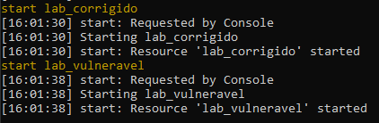
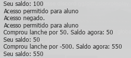

# Laboratório: falhas de segurança em resource de MTA:SA

Dois resources iguais em tudo, menos nas falhas. Um tem as duas vulnerabilidades abertas, o outro tem as correções. O objetivo é rodar a skill de análise em código Lua de servidor de jogo, que é o ambiente que eu uso no dia a dia.

> Só rode em servidor de laboratório, seu, sem jogadores reais. Os dados aqui são fictícios.

## Os dois cenários

| Cenário | Falha | CWE | Por que importa |
| --- | --- | --- | --- |
| Login com SQL montado na string | Injeção de SQL | CWE-89 | Dá para entrar sem saber a senha. |
| Servidor aceitando o preço enviado pelo cliente | Confiança no cliente | CWE-602 | O jogador compra pelo preço que quiser, inclusive negativo. |

O segundo é o mais comum em servidor de MTA e vale mais como aprendizado: é decisão de arquitetura. O servidor entrega ao cliente uma decisão que só ele deveria tomar.

## Estrutura

| Pasta | O que é |
| --- | --- |
| `lab_vulneravel/` | Resource com as duas falhas. |
| `lab_corrigido/` | Mesmo resource com consulta parametrizada, validação e preço no servidor. |

Cada resource tem `meta.xml`, `server.lua` e `client.lua`.

## Como rodar

1. Copie as duas pastas para `mods/deathmatch/resources/` do seu servidor.
2. No console, rode `refresh` e depois `start lab_vulneravel`.
3. Entre no servidor e use os comandos no chat.

**Rode um resource por vez.** Os dois registram os mesmos comandos, então dê `stop lab_vulneravel` antes de iniciar o `lab_corrigido`. Com os dois no ar, a resposta fica ambígua.

Na primeira vez, o resource cria a tabela `contas` e o usuário fictício `aluno` / `dio2026`.

O carregamento aparece assim no console:

```text
refresh
[16:00:47] New resource 'lab_corrigido' loaded
[16:00:47] New resource 'lab_vulneravel' loaded

start lab_vulneravel
[16:01:38] start: Requested by Console
[16:01:38] Starting lab_vulneravel
[16:01:38] start: Resource 'lab_vulneravel' started
```

Se no lugar de `started` aparecer erro, o problema está no `meta.xml` ou na sintaxe do Lua.



## Comandos de teste

| Comando | O que faz |
| --- | --- |
| `/saldo` | Mostra o saldo (começa em 100). |
| `/logar aluno dio2026` | Login válido. |
| `/logar aluno errada` | Login com senha incorreta. |
| `/logar aluno ' OR '1'='1` | Tentativa de injeção. |
| `/comprar lanche` | Compra normal, por 50, com o preço do servidor. |
| `/comprarhack lanche 0` | Cliente modificado mandando o preço. |

## Roteiro de teste

### No `lab_vulneravel`

```text
/saldo                        -> Seu saldo: 100
/logar aluno dio2026          -> Acesso permitido para aluno
/logar aluno errada           -> Acesso negado.
/logar aluno ' OR '1'='1      -> Acesso permitido para aluno
/comprar lanche               -> Comprou lanche por 50. Saldo agora: 50
/comprarhack lanche -500      -> Comprou lanche por -500. Saldo agora: 550
```

A linha do `/comprarhack` mostra a segunda falha: quem manda o preço é o cliente, e um preço negativo vira lucro.

### No `lab_corrigido`

Depois de `stop lab_vulneravel` e `start lab_corrigido`:

```text
/saldo                        -> Seu saldo: 100
/logar aluno ' OR '1'='1      -> Acesso negado.
/comprarhack lanche 0         -> Comprou lanche por 50. Saldo agora: 50
```

Os comandos que davam acesso e dinheiro agora não mudam nada: a injeção não passa e o servidor ignora o preço que veio do cliente. Se repetir a compra em menos de um segundo, aparece o aviso de intervalo.

## O que a análise encontrou

**Falha 1: injeção de SQL.** O valor digitado é colado na consulta com `..`. O banco recebe um comando diferente do que o programador escreveu. Correção: `?` no lugar do valor e os valores como argumentos do `dbQuery`.

**Falha 2: confiança no cliente.** O evento `comprarItem` está aberto (`addEvent(..., true)`) e o servidor usa o `preco` que veio do cliente. Um cliente modificado manda `0` ou um número negativo e compra de graça ou ganha dinheiro. Correção: preço em tabela do servidor, `client` no lugar de `source`, validação de tipo, conferência de saldo e intervalo mínimo entre compras.

Detalhe que vale destacar na análise: **`source` pode ser forjado** pelo cliente quando dispara `triggerServerEvent`. Para saber quem chamou de verdade, o servidor usa `client`. É o ponto mais fácil de passar batido no código.

## O que ainda ficaria de fora

Mesmo na versão corrigida, estes pontos continuam como exercício:

- senha guardada em texto puro no SQLite (CWE-916);
- ausência de limite de tentativas no `/logar`;
- saldo em memória, que zera quando o resource reinicia;
- nenhum registro de auditoria das compras.

Nenhum deles impede o laboratório de funcionar. Todos seriam apontados numa análise de verdade.

## Resultado dos testes

### No `lab_vulneravel`

```text
Seu saldo: 100
Acesso permitido para aluno
Acesso negado.
Acesso permitido para aluno
Comprou lanche por 50. Saldo agora: 50
Seu saldo: 50
Comprou lanche por -500. Saldo agora: 550
Seu saldo: 550
```



A injeção entrou com uma senha que não existe, e a compra por preço negativo virou lucro.
